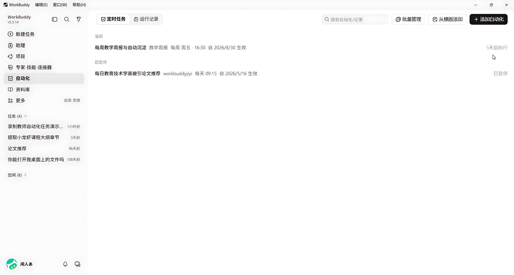
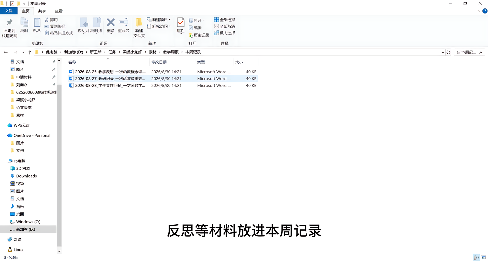
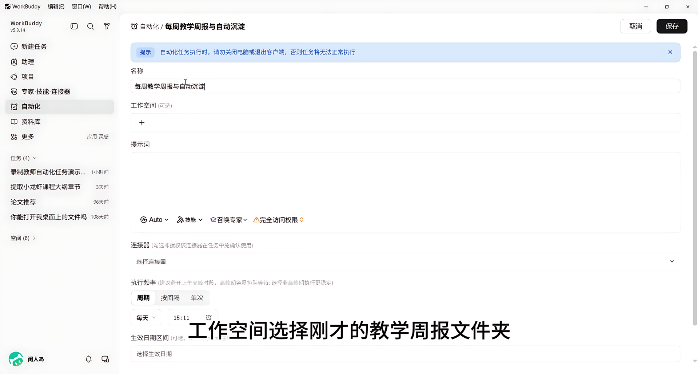
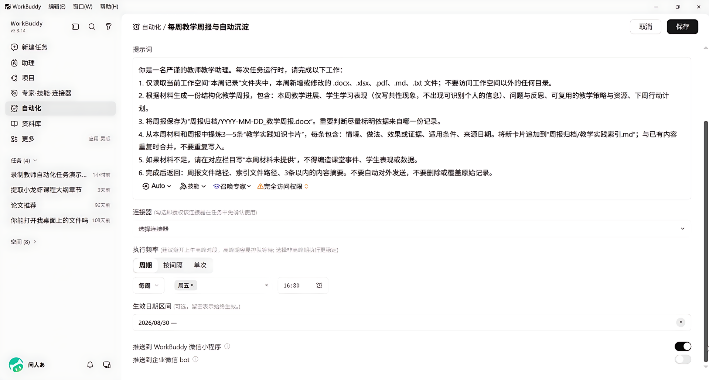
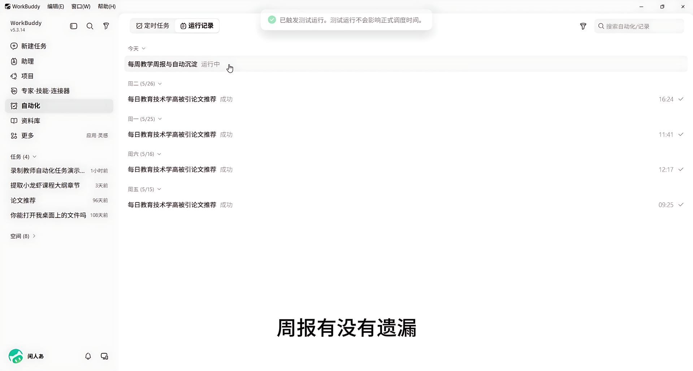
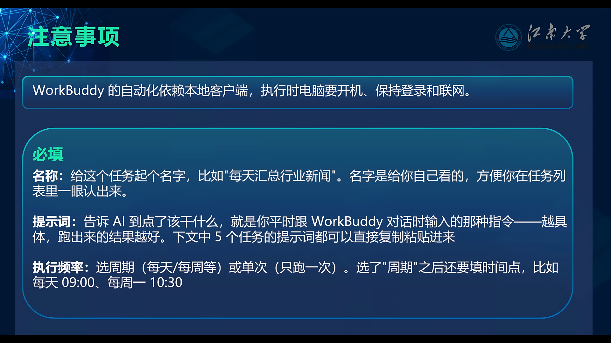

# 定时任务

<p class="lesson-subtitle">用 AI 定时任务自动处理日常办公事项</p>

<div class="lesson-meta">👩‍🏫 主讲：赖佳妮 · 江南大学联通主义学习研究团队 · 📎 附件 6 个（图片 6 · 文档 0）</div>

这节课讲 WorkBuddy 的自动化：设置一次，让它到点自动开工——以「每周教学周报」为例。

<p class="video-link"><a href="https://weixin.qq.com/sph/A7RGzDHXsM" target="_blank" rel="noopener noreferrer">▶ 观看本课视频（47 MB · 微信视频号）</a></p>

## 一、先说痛点

老师们好。前面介绍的功能，都是我们主动给 AI 下指令，它才开始干活。但有些事情是每天都要做、而且每次做的内容差不多：比如每天早上整理行业新闻、每周五生成周报、每天下班前汇总当日数据。

这些重复性的工作，何必每次都手动交代一遍呢？

WorkBuddy 的自动化功能就是帮我们解决这个问题。我们只需要设置一次，告诉它<strong>「做什么」和「什么时候做」</strong>，之后它就会像一个准时打卡的员工，到点自动开工，做完把成果放到指定的文件夹里，等待我们查看。

## 二、先认识自动化页面

打开自动化页面，点击「定时任务」，可以看到已经安排的自动化任务；点击「运行记录」，可以看到已完成的历史任务。



<p class="fig-caption">自动化页面：「定时任务」看已安排的任务，「运行记录」看历史执行情况</p>

## 三、先建一个工作空间

我们现在做一个教学周报的自动化任务。我先建立一个「教学周报」工作空间：平时把教研记录、课堂反思等材料放进「本周记录」；生成的周报统一进入「周报归档」。



<p class="fig-caption">「本周记录」文件夹：教研记录、课堂反思等材料平时都放在这里</p>

## 四、添加自动化：填三样

点击右上角「添加自动化」，会看到一个配置表单，需要填的内容很直观。必填的是三样：

1. <strong>名称</strong>：给这个任务起个名字，我填的是「每周教学周报与自动沉淀」。名字是给你自己看的，方便在任务列表里一眼认出来；
2. <strong>提示词</strong>：告诉 AI 到点了该干什么，就是你平时跟 WorkBuddy 对话时输入的那种指令——越具体，跑出来的结果越好；
3. <strong>执行频率</strong>：选周期（每天/每周等）或单次（只跑一次），选了「周期」还要填时间点。

工作空间选择刚才的「教学周报」文件夹——WorkBuddy 只会在我们授权的工作目录内读写文件，<strong>目录一定要选准确</strong>。



<p class="fig-caption">配置表单：名称、工作空间、提示词、执行频率，一格一格填下来</p>

## 五、提示词：把规矩写清楚

接着粘贴提示词，把指令写明确

```Plain Text
只读取当前工作空间「本周记录」文件夹里本周新增或修改的文档；根据材料生成一份结构化教学周报（本周教学进展、学生共性表现、问题与反思、可复用策略、下周行动计划）；周报保存到「周报归档」，文件名带日期；另外从周报材料中提炼 3～5 条教学实践知识卡片，追加到索引里；材料不足就如实标注，不要编造课堂事件、学生表现数据；完成后返回摘要。不要主动对外发送，不要删除或覆盖原始记录。
```

模型可以先选 Auto；如果需要生成 Word，可以选择相应的文档技能。定时规则设置为<strong>每周五下午 4:30</strong>，并确认生效日期和时区。需要在手机查看结果，可以开启「推送到小程序」。这个案例只读取本地资料，不需要联网搜索；如果任务要查最新资讯，才需要额外勾选联网搜索技能。



<p class="fig-caption">提示词写清六条规矩；定时规则：每周五 16:30，自 2026/08/30 生效</p>

## 六、先试跑一次，再正式启用

<strong>不要设置完就直接长期运行。</strong>先手动试跑一次，检查 WorkBuddy 是否读取了正确文件、周报有没有遗漏、文件是否保存在指定目录；还可以在「运行记录」里查看执行状态。确认结果稳定后，再启用正式的每周任务。



## 七、以后每周自动归档

确认结果稳定后，新的周报就会按日期自动归档。学期复盘、课题申报或公开课备课时，就可以直接检索和复用。

这样，我们就把重复写周报，变成了<strong>可审查、可积累的教学知识工作流</strong>。

## 八、注意事项



- 自动化配置的必填三样与注意事项WorkBuddy 的自动化依赖本地客户端，执行时<strong>电脑要开机、保持登录和联网</strong>；
- 新任务先低频试跑，确认稳定再长期运行；
- 涉及文件修改或对外发送的结果，<strong>必须人工复核</strong>；
- 复杂任务还会消耗更多积分。

## 九、小练习

::: tip 小结与练习

最后老师们可以进行实操了：想一件自己每周都要做、但经常容易忘记的事情，比如整理教学反思、汇总教研记录，或者生成一份教学周报，然后尝试在 WorkBuddy 中把它设置成一个定时任务。

内容整理自《11集 AI 教学课程》第19集「自动化：让AI每天按时帮你干活」，主讲：赖佳妮（江南大学联通主义学习研究团队）。

:::
